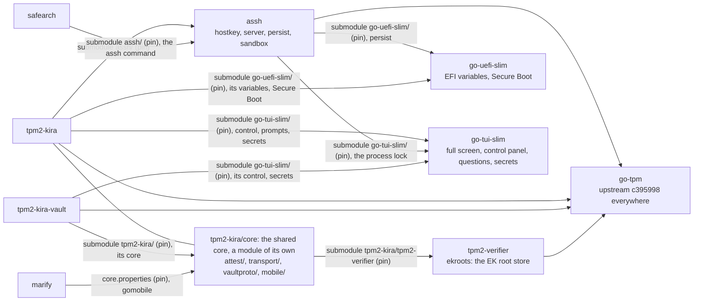

AGENTS.md

# OVERALL GUIDELINES - maintained by Owner
    
## Engineering principles 
        
- **Future-ready by default.** Every change you implement must be modular,
  cleanly separated, and secure. Structure code so that future changes are easy
  to add without rewriting what already exists. Prefer clear interfaces,
  minimal coupling, and sensible defaults.
- **Security is not optional.** Validate inputs, handle errors explicitly, and
  never expose secrets or credentials in code, that is subject to be commited.
  If you find in existing project a security issue - bring this up with a WARNING!
- **Privacy is not optional.** Solutions we design and work on are subject
  to be published. Do not include there private data. If such is needed,
  always create a template configuration file, fill the private data into a
  gitignored file.
  
## Planning — mandatory before any programming task
            
When the user requests a programming task, **do not start coding immediately.**
        
1. Read the existing `PLAN.md` in the project root (if it exists).
2. Create or update `PLAN.md` to reflect the requested task. Include:
   - **Goal:** what the user asked for, in your own words.
   - **Steps:** a numbered breakdown of what you will implement.
   - **Open questions:** anything you need clarified before starting.
3. Present the plan to the user and wait for confirmation before writing code.
4. As you complete steps, update `PLAN.md` to mark them done
   (e.g. `- [x] step`).
5. Keep `PLAN.md` up to date when requirements change mid-conversation.

## Coding principles

- if you have to decide for a programming language at the beginning of a project
  tell the user about the decision for one language and give him possiblities to weigthen
  the use of a language by himself.
- Use if possible always the possibilities of a programming language it ships 
  with instead of using a library
- If you have use a library, use as less as possible, focus on broadly used libraries
  that cover a lot of requirements at once.
- If you refactor code, do not leave a History Text at the place, where code has been removed.
  If the refactoring was due to some security issue, add the history text to a HISTORY.md

## Interfacing principles

- The user you are communicating with is an experienced Developer.
  Reduce your output to concrete formulations. If requested to explain something
  you can focus on technical in-depth explanations
- When giving command instructions, mark them with code blocks 
  ```
  code
  ``` 
  To make them clearly different from the text instructions

## Testing
    
- We like solutions, that can be tested. Especially Integration Testing.
  However if the task is complex to simulate ask the user about the plan to 
  implement for testing specifically.
        
## Backwards compatibility
        
- **We are in Developer Mode.** Do not preserve backwards compatibility unless
  the user explicitly asks for it.
- However, if a change you are about to make **breaks existing functionality**,
  warn the user clearly before proceeding. Explain what will break and why.
        
## Diagrams         
                    
- When visualising architecture, flows, or relationships, use **Mermaid**
  diagrams (in Markdown fenced code blocks with `mermaid` as language).
- Place diagrams in `PLAN.md`, `README.md`, or inline in your response —
  wherever they add the most clarity.

## Storage Location

- If you write helper scripts, never store something in /tmp/ - sessions might be continued after reboot and
  /tmp/* will be gone. Use /tmp/* only in case it is really temporary work - e.g. in the scripts you produce.

# PROJECT SPECIFIC GUIDELINES - maintained by LLM

## The tpm2-trust workspace

Each directory here is a project with a repository of its own. This
repository holds only what ties them together - `go.work`, `pin`, these
rules - and `.local/` (git-ignored: the VM test's password and other local
state that must survive a reboot, never `/tmp`). Each project's own
AGENTS.md applies inside it and goes into detail; this file is the map.

### The projects

| Directory | What it is | Language, module | Released as |
|---|---|---|---|
| `assh/` | aSSH: the SSH CA and host keys in the TPM, the privilege-separated SSH server, `persist` (NV indices, EFI variables), `sandbox` (confinement) | Go, `github.com/tpm2-trust/assh` | a library; the `assh` command (built by safearch) |
| `tpm2-kira/` | TOTP codes, phone and vault attestation, the disk's key at boot: `tpm2-kira` (installed system) and `tpm2-kira-boot` (boot image) | Go, `github.com/tpm2-trust/tpm2-kira` | Arch and Debian packages (`packaging/build-packages.sh`) |
| `tpm2-kira-vault/` | the vault: releases a key part to a TPM quote of an approved boot, over TLS | Go, `github.com/tpm2-trust/tpm2-kira-vault` | binary, container |
| `marify/` | Marify, the phone app: attests a boot over Bluetooth LE, keeps the phone salt | Kotlin (Android), Swift (iOS), the Go core bound with gomobile | APKs (`build-packages.sh apk`) |
| `safearch/` | a read-only, signed Arch image (mkosi) whose identity is aSSH's | shell, mkosi | images, releases (`build.sh`, `release.sh`) |
| `tpm2-verifier/` | EK certificate chains of TPM vendors; the curated EK root store every project uses (`ekroots`: the vendor data embedded, checked against its signed manifest) | Go, `github.com/tpm2-trust/tpm2-verifier` | binaries, packages; a library |
| `go-uefi-slim/` | UEFI for Go on Linux: EFI variables (`efivar`), Secure Boot's signature databases, signed updates and Authenticode, in what sbctl writes and reads, and unified kernel images (`uki`: sections, PCR 11's measurements, `.pcrsig`); the standard library and x/sys alone | Go, `github.com/tpm2-trust/go-uefi-slim` | a library |
| `go-tui-slim/` | a terminal program's full screen and questions, and its secrets: `tui` (the screen, keys, text, held output), `panel` (a control panel on it: sections, steps, their detail, the loop), `prompt` (questions, a password into a locked buffer), `termguard` (the terminal given back on every way out), `secret` (wipe, locked buffers, a process locked in memory and not dumpable); knows nothing of its users; the standard library and x/sys alone | Go, `github.com/tpm2-trust/go-tui-slim` | a library |

Where they are published: github.com/tpm2-trust/<directory>, this
workspace as `tpm2-trust/tpm2-trust`. A pin only resolves for
others once the commit it names is on a published branch.

### How they depend on each other



| Consumer | Uses | How it is pinned | Moved by |
|---|---|---|---|
| tpm2-kira | aSSH as a library (`hostkey`, `server`, `persist`, `sandbox`) | submodule `assh/`, `replace` in go.mod | `./pin assh` |
| safearch | aSSH as a command (`ca`, `agent`, `tpm sha1`, `efivar`) in the image and the initrd | submodule `assh/` | `./pin assh` |
| tpm2-kira | its core (`github.com/tpm2-trust/tpm2-kira/core`) | `replace ./core`: the same repository | - |
| Marify | the core's `mobile/kiracore` (and `kiratest`), with `attest/` and `transport/frame` | `core.properties` (a commit of tpm2-kira) | `./pin tpm2-kira` |
| tpm2-kira-vault | the core's `attest/` and `vaultproto/` | submodule `tpm2-kira/`, `replace ./tpm2-kira/core` in go.mod | `./pin tpm2-kira` |
| aSSH | go-uefi-slim's `efivar` (`persist`: its CA in an EFI variable), `uki` (PCR signatures) | submodule `assh/go-uefi-slim`, `replace ./go-uefi-slim` in go.mod (safearch's build of the command takes it nested: `assh/go-uefi-slim`) | `./pin go-uefi-slim` |
| tpm2-kira | go-uefi-slim (its own EFI variables, Secure Boot, `uki`) | submodule `tpm2-kira/go-uefi-slim`, `replace ./go-uefi-slim` in go.mod (aSSH's replace does not reach it) | `./pin go-uefi-slim` |
| aSSH | go-tui-slim's `secret` (the process locked in memory, not dumpable, before a PIN is read) | submodule `assh/go-tui-slim`, `replace ./go-tui-slim` in go.mod (safearch's build of the command takes it nested: `assh/go-tui-slim`) | `./pin go-tui-slim` |
| tpm2-kira | go-tui-slim (`control`'s full screen: `panel`; the prompts, the secrets' buffers) | submodule `tpm2-kira/go-tui-slim`, `replace ./go-tui-slim` in go.mod | `./pin go-tui-slim` |
| tpm2-kira-vault | go-tui-slim (its `control`, prompts, secrets) | submodule `tpm2-kira-vault/go-tui-slim`, `replace ./go-tui-slim` in go.mod - its own, not nested through `tpm2-kira/`, so the vault's screen does not move with the core's pin | `./pin go-tui-slim` |
| tpm2-kira's core (and so the phone and the vault) | tpm2-verifier's `ekroots` | submodule `tpm2-kira/tpm2-verifier`, `replace ../tpm2-verifier` in `core/go.mod` (and `./tpm2-verifier` in tpm2-kira's, `./tpm2-kira/tpm2-verifier` in the vault's) | `./pin tpm2-verifier` |
| every Go module (aSSH, tpm2-kira, its core, the vault, tpm2-verifier) | go-tpm | one pseudo-version in each go.mod, the same everywhere: they end up in one binary; no `replace` of it anywhere; `./pin status` warns when they differ | by hand, in every module at once |

Rules of the direction:

- **aSSH knows nothing of its users.** It is the shared bottom: what two
  projects both need about the TPM, SSH, EFI variables or confinement goes
  there, generic, with its tests; never a tpm2-kira or safearch notion.
- **What the phone and the vault speak with tpm2-kira lives in tpm2-kira's
  core**, `tpm2-kira/core/` - a Go module of its own
  (`github.com/tpm2-trust/tpm2-kira/core`: `attest/`, `transport/`,
  `vaultproto/`, `mobile/`), which requires go-tpm, x/crypto and
  tpm2-verifier (its `ekroots`) alone. The
  module boundary keeps tpm2-kira's `internal/` and aSSH out of it; the
  phone binds it with gomobile, the vault requires it, and both get nothing
  else. A change there is a change to the protocol of all three: their
  tests run (below).
- **The TPM vendors' EK roots are tpm2-verifier's `ekroots`**, for every
  project: vendors are added there (two independent sources, the signed
  manifest), never as a copy elsewhere. A TPM of a vendor not in the store
  is "vendor not known" - a risk to weigh, not untrusted - everywhere it is
  shown.
- **EFI variables go through the workspace's `go-uefi-slim` module**, which neither aSSH nor
  tpm2-kira owns (the standard library and x/sys alone).
  - aSSH's `persist` uses it for aSSH's variables (its CA file, `efi:NAME`).
  - tpm2-kira uses it directly, not through aSSH, for its own variables (the
    machine-id, the slots' records) and for Secure Boot's (PK, KEK, db, dbx).
  - safearch's scripts use the `assh efivar` command.
  - What both need about UEFI goes into `go-uefi-slim`, generic, with its tests; never a copy in
    a project, never aSSH's.
  - NV indices stay with aSSH's `persist`.
- **A terminal program's screen, questions and secrets go through `go-tui-slim`**, which
  neither tpm2-kira nor the vault owns (the standard library and x/sys alone): `control`'s
  full screen (`panel`: the sections, steps and keys; the user gives the texts and runs the steps) and line menus, every question, every password read into a locked buffer and
  wiped, the process locked in memory. What both need of a terminal goes there, generic, with
  its tests; never a copy in a project. A secret is never a Go string there.
- **A new dependency between projects** gets a row in the tables above,
  a pin that `./pin status` shows (extend `pin`), and release builds that
  build the pin (`GOWORK=off`), not the checkout.

### Key algorithms

When a key type is ours to choose:

- **Ed25519 wherever every party that uses the key supports it** (SSH user keys, for
  example).
- **Otherwise RSA, at the greatest length every one of those parties accepts, rather
  than ECDSA.**
  - A TPM, UEFI Secure Boot and a PIV token often have no Ed25519.
  - "Accepts" is decided from the device where it can be asked (a TPM: `TPM2_TestParms`).
    swtpm 0.10 takes RSA up to 3072; many hardware TPMs only take 2048.
  - A key the TPM has to verify can be no longer than the TPM takes.
- **ECDSA only where RSA is not possible.**

### Old machines

No project keeps an existing installation working across a change: a
machine is set up again (a CA made again, a phone enrolled again, an image
rebuilt), never migrated - in every project, not only where its own
AGENTS.md says so. What still has to be said, every time and before the
change: which former functionality breaks, and what the owner has to redo.

### Working across projects

- **Edit a project in its checkout here, never in a copy of it inside
  another.** `tpm2-kira/assh` and `safearch/assh` are submodules: pins of a
  commit of `assh/`, from which releases are built; so is
  `tpm2-kira-vault/tpm2-kira`, a pin of tpm2-kira for its core. A change to aSSH is
  made and committed in `assh/`; `./pin assh` then moves both submodules to
  it and stages the new pointers, which are committed in tpm2-kira and
  safearch. Go refuses to build inside a submodule here (it is not in
  `go.work`), which is the reminder.
- **Development builds use the checkouts, releases the pins.** `go.work`
  makes `go build` and `go test` in assh, tpm2-kira, its core and the vault
  use each other's checkouts, so a change reaches the others before it is committed.
  Every release build sets `GOWORK=off` and builds the pinned commits:
  tpm2-kira's PKGBUILD and debian/rules, safearch's `lib/assh.sh` and its
  tests, the vault's `make build`, Marify's `build-core.sh` (from a fresh
  archive). Where two projects replace the same module with their own
  copies (the core: tpm2-kira's `./core`, the vault's submodule),
  `go.work` replaces it at the required version with the checkout. A new release
  build does the same.
- **`./pin status` before a release, and after a change to a project
  others use.** It shows every pin against the checkout it pins: the aSSH
  submodules, Marify's `core.properties` (the tpm2-kira commit the app
  links) and the vault's submodule `tpm2-kira/` (both moved by `./pin
  tpm2-kira`), go-tpm, which tpm2-kira and aSSH pin by intent and `pin`
  shows without moving, and the AUR recipe's commits of tpm2-kira's submodules
  (`packaging/aur/PKGBUILD`, which GitHub's tarballs need), shown against its
  pins and set with its `_tag` at a release.
- **Pinning is staging.** `pin` never commits; the commit of a new pin is
  the consuming project's, with its tests run against it.

### What to test after a change

Test by what changed, and no more; the full proof belongs to the end of a batch.

| Changed | Run |
|---|---|
| Docs only | nothing |
| Test tools | the affected scenario alone (`vmtest.py --only SCENARIO`) |
| Installed-system code of tpm2-kira (`control`, `status`, the admin commands) | `make test-all` |
| tpm2-kira's boot, close or unlock | `make test-all`; `tools/vmtest.py --fast-kdf`; the affected scenarios, from a saved setup |
| Argon2id, or what memory the boot takes | as above, at the real cost (without `--fast-kdf`), on the affected boots |
| `tpm2-kira/core/` | as for the boot; the vault's tests. Marify's `android/scripts/test-emulator.sh` at the end of the batch, after `./pin tpm2-kira` |
| `assh/` | its tests (`go test ./...`, swtpm); tpm2-kira's `make test-all` against it (`go.work`); safearch's `tests/run.sh` after `./pin assh` |
| `tpm2-kira-vault/` | its tests; the vault steps of `tools/vmtest.py` at the end of the batch |
| `go-uefi-slim/` | its tests (the immutable test as root on a VM); aSSH's and tpm2-kira's suites after `./pin go-uefi-slim` |
| `go-tui-slim/` | its tests (the process lock's "covers" as root on a VM); aSSH's tests, tpm2-kira's `make test-all` and the vault's tests against it (`go.work`); after `./pin go-tui-slim`, safearch's `tests/run.sh` and the vmtest scenarios that drive `control` (setup) |
| `tpm2-verifier/` | its tests; `core`'s and the vault's after `./pin tpm2-verifier` |
| `safearch/` | `tests/run.sh`; `tests/vm.sh` at the end of the batch, when the boot changed |

`tools/test-affected.py` (tpm2-kira; `--since TIME` for a batch) prints what this table asks for the changes against a base, and starts nothing; a test keeps its table and this one in step.

The depths of testing, what runs at each and what none of them covers: `tpm2-kira/docs/TESTING.md`, "Test depths".

**The proof, once per batch, before the owner pushes:** `tools/proof.py --since <the batch's start>`, one command, from `fresh`, without `--fast-kdf`: both machines in parallel through the scenarios that have a budget, beside them `make test-all` with nothing `(cached)`, aSSH's tests, the vault's and safearch's `tests/run.sh`. **15-20 minutes wall clock are an orientation, not a limit:** time fails nothing, budgets are information, and a run over 20 minutes says so in its report with what went over. Only a run that hangs is stopped, after an hour, and reported as stuck. The parts without a VM start when the machines' setups are done. Parts the table names on top run after it. A run with `--fast-kdf`, from a saved setup or with `--only` is never the proof; a report says which it was.

**`tools/proof.py --all`, before a release, the owner's call:** every scenario the proof left out, by name, `tests/vm.sh` and Marify.

**No full run while a scenario fails.** Each is proven alone from a saved setup first (`vmtest.py --only SCENARIO`), then one proof; if it fails, that scenario alone again. **A run expected over 10 minutes is announced first.**

**A run of yours:** iterate from a saved setup (`--save-setup`, `--only`; `tpm2-kira/docs/TESTING.md`). A wait for a run ends on the run's failure too, not only on the line it hopes for. Stage what you changed by name: a shared checkout may hold another agent's work.

The VM test and the emulator test run without anyone at the keyboard from
a defined state (tpm2-kira `docs/TESTING.md`, Marify `android/TESTING.md`);
their runs and logs go into the project or `.local/`, not `/tmp`.

