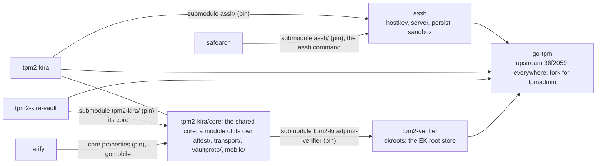

AGENTS.md

# OVERALL GUIDELINES - maintained by Owner
    
## Engineering principles 
        
- **Future-ready by default.** Every change you implement must be modular,
  cleanly separated, and secure. Structure code so that future changes are easy
  to add without rewriting what already exists. Prefer clear interfaces,
  minimal coupling, and sensible defaults.
- **Security is not optional.** Validate inputs, handle errors explicitly, and
  never expose secrets or credentials in code, that is subject to be commited.
  If you find in existing project a security issue - bring this up with a WARNING!
- **Privacy is not optional.** Solutions we design and work on are subject
  to be published. Do not include there private data. If such is needed,
  always create a template configuration file, fill the private data into a
  gitignored file.
  
## Planning — mandatory before any programming task
            
When the user requests a programming task, **do not start coding immediately.**
        
1. Read the existing `PLAN.md` in the project root (if it exists).
2. Create or update `PLAN.md` to reflect the requested task. Include:
   - **Goal:** what the user asked for, in your own words.
   - **Steps:** a numbered breakdown of what you will implement.
   - **Open questions:** anything you need clarified before starting.
3. Present the plan to the user and wait for confirmation before writing code.
4. As you complete steps, update `PLAN.md` to mark them done
   (e.g. `- [x] step`).
5. Keep `PLAN.md` up to date when requirements change mid-conversation.

## Coding principles

- if you have to decide for a programming language at the beginning of a project
  tell the user about the decision for one language and give him possiblities to weigthen
  the use of a language by himself.
- Use if possible always the possibilities of a programming language it ships 
  with instead of using a library
- If you have use a library, use as less as possible, focus on broadly used libraries
  that cover a lot of requirements at once.
- If you refactor code, do not leave a History Text at the place, where code has been removed.
  If the refactoring was due to some security issue, add the history text to a HISTORY.md

## Interfacing principles

- The user you are communicating with is an experienced Developer.
  Reduce your output to concrete formulations. If requested to explain something
  you can focus on technical in-depth explanations
- When giving command instructions, mark them with code blocks 
  ```
  code
  ``` 
  To make them clearly different from the text instructions

## Testing
    
- We like solutions, that can be tested. Especially Integration Testing.
  However if the task is complex to simulate ask the user about the plan to 
  implement for testing specifically.
        
## Backwards compatibility
        
- **We are in Developer Mode.** Do not preserve backwards compatibility unless
  the user explicitly asks for it.
- However, if a change you are about to make **breaks existing functionality**,
  warn the user clearly before proceeding. Explain what will break and why.
        
## Diagrams         
                    
- When visualising architecture, flows, or relationships, use **Mermaid**
  diagrams (in Markdown fenced code blocks with `mermaid` as language).
- Place diagrams in `PLAN.md`, `README.md`, or inline in your response —
  wherever they add the most clarity.

## Storage Location

- If you write helper scripts, never store something in /tmp/ - sessions might be continued after reboot and
  /tmp/* will be gone. Use /tmp/* only in case it is really temporary work - e.g. in the scripts you produce.

# PROJECT SPECIFIC GUIDELINES - maintained by LLM

## The tpm2-trust workspace

Each directory here is a project with a repository of its own. This
repository holds only what ties them together - `go.work`, `pin`, these
rules - and `.local/` (git-ignored: the VM test's password and other local
state that must survive a reboot, never `/tmp`). Each project's own
AGENTS.md applies inside it and goes into detail; this file is the map.

### The projects

| Directory | What it is | Language, module | Released as |
|---|---|---|---|
| `assh/` | aSSH: the SSH CA and host keys in the TPM, the privilege-separated SSH server, `persist` (NV indices, EFI variables), `sandbox` (confinement) | Go, `github.com/tpm2-trust/assh` | a library; the `assh` command (built by safearch) |
| `tpm2-kira/` | TOTP codes, phone and vault attestation, the disk's key at boot: `tpm2-kira` (installed system) and `tpm2-kira-boot` (boot image) | Go, `github.com/mrwiora/tpm2-kira` | Arch and Debian packages (`packaging/build-packages.sh`) |
| `tpm2-kira-vault/` | the vault: releases a key part to a TPM quote of an approved boot, over TLS | Go, `github.com/tpm2-trust/tpm2-kira-vault` | binary, container |
| `marify/` | Marify, the phone app: attests a boot over Bluetooth LE, keeps the phone salt | Kotlin (Android), Swift (iOS), the Go core bound with gomobile | APKs (`build-packages.sh apk`) |
| `safearch/` | a read-only, signed Arch image (mkosi) whose identity is aSSH's | shell, mkosi | images, releases (`build.sh`, `release.sh`) |
| `tpm2-verifier/` | EK certificate chains of TPM vendors; the curated EK root store every project uses (`ekroots`: the vendor data embedded, checked against its signed manifest) | Go, `github.com/tpm2-trust/tpm2-verifier` | binaries, packages; a library |
| `go-tpm/` | the go-tpm fork (`NVChangeAuth`), for aSSH's `tpmadmin` | Go | - |
| `mkinitcpio-systemd-extras/` | sd-network and sd-tinyssh hooks; no project here uses them any more (tpm2-kira's SSH server replaced them, tpm2-kira HISTORY.md) | shell | - |

### How they depend on each other



| Consumer | Uses | How it is pinned | Moved by |
|---|---|---|---|
| tpm2-kira | aSSH as a library (`hostkey`, `server`, `persist`, `sandbox`) | submodule `assh/`, `replace` in go.mod | `./pin assh` |
| safearch | aSSH as a command (`ca`, `agent`, `tpm sha1`, `efivar`) in the image and the initrd | submodule `assh/` | `./pin assh` |
| tpm2-kira | its core (`github.com/mrwiora/tpm2-kira/core`) | `replace ./core`: the same repository | - |
| Marify | the core's `mobile/kiracore` (and `kiratest`), with `attest/` and `transport/frame` | `core.properties` (a commit of tpm2-kira) | `./pin tpm2-kira` |
| tpm2-kira-vault | the core's `attest/` and `vaultproto/` | submodule `tpm2-kira/`, `replace ./tpm2-kira/core` in go.mod | `./pin tpm2-kira` |
| tpm2-kira's core (and so the phone and the vault) | tpm2-verifier's `ekroots` | submodule `tpm2-kira/tpm2-verifier`, `replace ../tpm2-verifier` in `core/go.mod` (and `./tpm2-verifier` in tpm2-kira's, `./tpm2-kira/tpm2-verifier` in the vault's) | `./pin tpm2-verifier` |
| every Go module (aSSH, tpm2-kira, its core, the vault, tpm2-verifier) | go-tpm | one pseudo-version in each go.mod, the same everywhere: they end up in one binary (aSSH's `replace` to the fork reaches `tpmadmin` alone); `./pin status` warns when they differ | by hand, in every module at once |

Rules of the direction:

- **aSSH knows nothing of its users.** It is the shared bottom: what two
  projects both need about the TPM, SSH, EFI variables or confinement goes
  there, generic, with its tests; never a tpm2-kira or safearch notion.
- **What the phone and the vault speak with tpm2-kira lives in tpm2-kira's
  core**, `tpm2-kira/core/` - a Go module of its own
  (`github.com/mrwiora/tpm2-kira/core`: `attest/`, `transport/`,
  `vaultproto/`, `mobile/`), which requires go-tpm, x/crypto and
  tpm2-verifier (its `ekroots`) alone. The
  module boundary keeps tpm2-kira's `internal/` and aSSH out of it; the
  phone binds it with gomobile, the vault requires it, and both get nothing
  else. A change there is a change to the protocol of all three: their
  tests run (below).
- **The TPM vendors' EK roots are tpm2-verifier's `ekroots`**, for every
  project: vendors are added there (two independent sources, the signed
  manifest), never as a copy elsewhere. A TPM of a vendor not in the store
  is "vendor not known" - a risk to weigh, not untrusted - everywhere it is
  shown.
- **A new dependency between projects** gets a row in the tables above,
  a pin that `./pin status` shows (extend `pin`), and release builds that
  build the pin (`GOWORK=off`), not the checkout.

### Working across projects

- **Edit a project in its checkout here, never in a copy of it inside
  another.** `tpm2-kira/assh` and `safearch/assh` are submodules: pins of a
  commit of `assh/`, from which releases are built; so is
  `tpm2-kira-vault/tpm2-kira`, a pin of tpm2-kira for its core. A change to aSSH is
  made and committed in `assh/`; `./pin assh` then moves both submodules to
  it and stages the new pointers, which are committed in tpm2-kira and
  safearch. Go refuses to build inside a submodule here (it is not in
  `go.work`), which is the reminder.
- **Development builds use the checkouts, releases the pins.** `go.work`
  makes `go build` and `go test` in assh, tpm2-kira, its core and the vault
  use each other's checkouts, so a change reaches the others before it is committed.
  Every release build sets `GOWORK=off` and builds the pinned commits:
  tpm2-kira's PKGBUILD and debian/rules, safearch's `lib/assh.sh` and its
  tests, the vault's `make build`, Marify's `build-core.sh` (from a fresh
  archive). Where two projects replace the same module with their own
  copies (the core: tpm2-kira's `./core`, the vault's submodule),
  `go.work` replaces it at the required version with the checkout. A new release
  build does the same.
- **`./pin status` before a release, and after a change to a project
  others use.** It shows every pin against the checkout it pins: the aSSH
  submodules, Marify's `core.properties` (the tpm2-kira commit the app
  links) and the vault's submodule `tpm2-kira/` (both moved by `./pin
  tpm2-kira`), and go-tpm, which tpm2-kira and aSSH pin by intent and `pin`
  shows without moving.
- **Pinning is staging.** `pin` never commits; the commit of a new pin is
  the consuming project's, with its tests run against it.

### What to test after a change

| Changed | Run |
|---|---|
| `assh/` | its tests (`go test ./...`, swtpm); tpm2-kira's suite against it (`go.work`); safearch's `tests/run.sh` after `./pin assh` |
| tpm2-kira's `internal/`, the boot integration | `make test-all` (unit and integration, swtpm); `tools/vmtest.py --target both` on fresh VMs |
| `tpm2-kira/core/` | the above (`make test-unit` runs the core's tests in `core/`), the vault's tests, Marify's `android/scripts/test-emulator.sh` (JVM, emulator and swtpm tests) after `./pin tpm2-kira` |
| `tpm2-kira-vault/` | its tests; `tools/vmtest.py` (the vault steps) |
| `safearch/` | `tests/run.sh` (and `tests/vm.sh` for a boot) |

The VM test and the emulator test run without anyone at the keyboard from
a defined state (tpm2-kira `docs/TESTING.md`, Marify `android/TESTING.md`);
their runs and logs go into the project or `.local/`, not `/tmp`.

