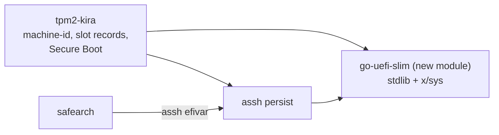

# PLAN: go-tpm upstream everywhere (the fork goes)

Status: **done (2026-10-31)**: steps 1-7; the VM test of tpm2-kira 7f182b5 passes on both machines.

## Goal

google/go-tpm took `NVChangeAuth` (#452, `c395998`, 2026-10-30). Every Go module
requires that commit, aSSH's `replace` to the fork goes, and with it the
exception that `tpmadmin` builds against other code than the rest. The fork's
commit `f241ee1` has the same tree as upstream `c395998`: nothing changes for
`tpmadmin`; the others gain #447-#452 (DA lockout reset and parameters, union
selector fix, NVChangeAuth).

## Steps

- [x] 1. aSSH (`4a8b77e`): `github.com/google/go-tpm v0.9.9-0.20261030171821-c395998989d7`,
       the `replace` removed; AGENTS.md ("hostkey builds with go-tpm as
       released": no fork any more). Tests (swtpm, tpmadmin's PIN change).
- [x] 2. tpm2-verifier (`cd31a77`): the same version; tests; `./pin tpm2-verifier`.
- [x] 3. tpm2-kira and its core (`7f182b5`; `make test-all` passes): the same version, the new aSSH and verifier
       pins; `make test-all`; the VM test.
- [x] 4. The vault (`751a5dc`, on `feat/root-ca`; unit and integration tests pass): the same version, `./pin tpm2-kira`; its tests.
- [x] 5. Marify (`613c488`; emulator test ALL PASS: 57 unit, 41 instrumented, 7 swtpm): `./pin tpm2-kira` (core.properties); the emulator test.
- [x] 6. Workspace: AGENTS.md (the `go-tpm/` row, the diagram, the go-tpm row
       of the pins), `pin` (no "assh's replace" line).
- [x] 7. The `go-tpm/` checkout leaves the workspace (it stays published).

## Open questions

1. ~~Step 7: remove the `go-tpm/` checkout?~~ Decided: yes (removed; every
   commit of it was on the fork's remote).
2. ~~The vault on `feat/root-ca` or a branch of its own?~~ Decided: on
   `feat/root-ca`.

# PLAN: a UEFI package of our own (replaces the go-uefi fork)

Status: **phases 1 and 2 built (2026-10-30)**: `go-uefi-slim/` (local commits, not published), used by
aSSH (`feat/uefi`) and tpm2-kira (`feat/uefi`); tpm2-kira's VM test passes on both machines
(fe8ae22, 129 checks each). Decisions: BSD
3-Clause; x/sys; built now and used in the projects; go-uefi fork branches stay. Renamed
`go-uefi-slim` (2026-10-31); `sigdb` takes every signature type of the specification.

## Goal

sbctl's upstream does not take the fork's efivarfs changes, so the fork stays a fork. A
package of our own replaces it:
- small, with the Go standard library alone (`golang.org/x/sys` at most, which aSSH and
  tpm2-kira already require);
- shared by aSSH and tpm2-kira, owned by neither (workspace AGENTS.md: "one shared EFI
  variable package that neither project owns");
- compatible with what sbctl writes and reads (Secure Boot layout, signature lists,
  signed variables), so sbctl can still take over a machine.

Measured cost of go-uefi in aSSH (2026-10-30), which this avoids:
- +422 KB binary;
- three new modules (go-uefi, afero, `pkg/errors`), plus `x/text`;
- a fork every consumer has to replace.

## What the standard library already has

- `debug/pe`: sections, the data directories, for Authenticode's hash.
- `encoding/asn1`, `crypto/x509`, `crypto`: PKCS#7 SignedData built by hand (no library),
  certificates, any `crypto.Signer` (a key file, the YubiKey through tpm2-kira's
  `internal/piv`).
- `encoding/binary`, `unicode/utf16`: variable and signature list layouts, names.
- `syscall` (`SYS_IOCTL`, `FS_IOC_GETFLAGS/SETFLAGS`) or `x/sys/unix`: the immutable bit.

## Steps

### Phase 1: EFI variables (for aSSH's `persist` and tpm2-kira; replaces the fork now)

- [x] 1. Repository `github.com/tpm2-trust/go-uefi-slim` (named 2026-10-31; first `uefi`), in the workspace
       as `go-uefi-slim/`. `go.work use`, a row in AGENTS.md's tables, `./pin status`.
- [x] 2. Package `efivar`:
       - `GUID` (parse, format, the mixed-endian binary form);
       - `Attributes`;
       - `Store{Dir}` (default `/sys/firmware/efi/efivars`) with:
         - `Read(name, guid) (Attributes, []byte, error)`;
         - `Write(name, guid, attrs, data)`: one write, truncate, append only with
           `APPEND_WRITE`;
         - `Remove(name, guid)`: a missing variable is `os.ErrNotExist`;
         - `List(guid)`.
       - Name check as `persist` does today.
       - The immutable bit: a check never creates; a write or removal lifts it and puts
         it back, also after a failure; only on the OS file system.
- [x] 3. Tests:
       - a temp directory: replace, a shorter rewrite, remove, a missing one, other
         attributes;
       - the immutable test skipped without `CAP_LINUX_IMMUTABLE`;
       - fuzzing the parsers;
       - on both VMs as root against efivarfs (as done for the fork).
- [x] 4. aSSH:
       - `persist` on `efivar` (same API);
       - the uncommitted go-uefi rework undone (go.mod, go.sum, `persist/efivar.go`; the
         README, TODO-SEC and HISTORY texts rewritten);
       - aSSH's tests;
       - tpm2-kira's `make test-all` against it.
- [x] 5. Workspace:
       - `go.work`: `./go-uefi-slim` instead of `./go-uefi`;
       - `pin`: the go-uefi check goes, the new module is shown like a pin.

### Phase 2: Secure Boot (for tpm2-kira's plan; built when that plan starts)

- [x] 6. `sigdb`: EFI_SIGNATURE_LIST / EFI_SIGNATURE_DATA, parse and build:
       - X.509 and SHA-256 entries;
       - the well-known GUIDs (global, image security database, Microsoft's owner);
       - the state: SecureBoot, SetupMode, PK, KEK, db, dbx, MokListRT.
- [x] 7. `authvar`: EFI_VARIABLE_AUTHENTICATION_2:
       - a timestamp plus PKCS#7 SignedData over name, GUID, attributes, timestamp and
         data;
       - signed by a `crypto.Signer`;
       - written through `efivar`.
- [x] 8. `authenticode`:
       - the PE image hash (`debug/pe`; checksum and certificate table left out);
       - SpcIndirectDataContent in SignedData, appended as WIN_CERTIFICATE;
       - the PE checksum updated;
       - verify against a certificate.
- [x] 9. Tests:
       - vectors from sbsigntools (`sbverify` in a container) and from sbctl (files it
         signed, enrolment files it exported);
       - fuzzing PE and signature lists;
       - the VM enrolment in Setup Mode (tpm2-kira's step 10).

## Results (2026-10-30)

- **Unit tests and fuzzing** for every package.
- **Reference tools** (Debian trixie):
  - `sbverify` accepts an image signed here;
  - an image `sbsign` signed verifies here;
  - a signature list is byte-identical to `cert-to-efi-sig-list`'s;
  - an update from `sign-efi-sig-list` verifies here.
- **Microsoft's certificates:** downloaded from Microsoft, identical to sbctl's, pinned.
- **Firmware** (OVMF with Secure Boot, `go-uefi-slim/internal/vmcheck`):
  - **Arch:** keys created as sbctl lays them out, its systemd-boot and UKI signed here.
    - It boots with Secure Boot on.
    - `sbctl status` and `sbctl verify` read the result as sbctl's own.
    - A UKI changed by one byte is refused ("Access denied").
  - **Debian:** boots through shim with Microsoft's certificates as enrolled here.
    - Side finding: Debian's kernel locks down under Secure Boot, which disables
      hibernation.
- **Projects:**
  - aSSH's suite passes;
  - tpm2-kira's `make test-all` passes; its VM test (`fe8ae22`) passes on Arch and Debian, 129
    checks each: slot records, the sealed machine-id and the SSH CA's variable on efivarfs;
  - safearch's `tests/run.sh`: 329 passed, 1 failed - `ASSH_CA_WINDOW`, the pending safearch
    upgrade (TODO-ASSH.md), not this.

## Open

- Publishing `github.com/tpm2-trust/go-uefi-slim` (the submodules' URL); until then builds work
  from the local checkouts only.
- safearch: its pin of aSSH and the nested-submodule check in `lib/assh.sh` are uncommitted;
  the safearch upgrade (TODO-ASSH.md) is not started.

# PLAN: the workspace's structure, as it grows

## Goal

The projects depend on each other more with every feature (aSSH under
tpm2-kira and safearch, tpm2-kira's core under the vault and Marify, three
go-tpm versions). Make every dependency explicit, pinned and cheap to
follow, and remove the duplicates, before more is built on top.

## Findings

1. **tpm2-kira's shared core is not a module of its own.** `attest/`,
   `transport/`, `vaultproto/` and `mobile/` depend on go-tpm and
   x/crypto alone, but the vault and Marify take them through the whole
   `github.com/mrwiora/tpm2-kira` module: its go.mod requires aSSH
   (replaced by a submodule), huh, go-attestation. Marify's core build has
   to edit that go.mod (drop aSSH) to build at all; the vault's module
   graph carries tpm2-kira's TUI libraries.
2. **The vault is not pinned.** `replace ../tpm2-kira` builds whatever the
   checkout is; every other consumer builds a pinned commit for a release.
3. **Two curated EK root stores.** tpm2-kira's `attest/ekroots/` (embedded
   into the phone app, Intel PTT) and tpm2-verifier's `vendors/` (a signed
   directory next to the binary, Intel) each pin vendor roots, with their
   own verification code.
4. **Three go-tpm versions.** tpm2-kira: upstream `36f2059` (the HMAC
   fix); aSSH: the same, plus a `replace` to the fork for `tpmadmin`;
   tpm2-verifier: v0.9.8.
5. **`pin` knows its pins by code.** Each new dependency means editing the
   script.
6. **`mkinitcpio-systemd-extras/` is used by nothing here** (tpm2-kira's
   own SSH server replaced its hooks).
7. **Nothing is pushed, and the workspace repository has no remote.** The
   submodules point at commits only these checkouts have.

## Steps (proposed - nothing is done before confirmation)

- [x] 1. **The shared core as a module of its own** (decided: inside tpm2-kira), in tpm2-kira's
      repository: `core/` with its own go.mod
      (`github.com/mrwiora/tpm2-kira/core`), holding `attest/`,
      `transport/`, `vaultproto/`, `mobile/`. tpm2-kira requires it
      (`replace ./core`), `go.work` uses it; the vault and Marify require
      the core alone. Marify's build-core drops its go.mod edit. The
      module boundary keeps the core free of tpm2-kira's `internal/` and
      of aSSH (it cannot import what its go.mod does not require).
      Done: tpm2-kira 86340f0, the vault 6c8c112, Marify 95ea722, the
      workspace e9d75fd; tpm2-kira's and the core's suites pass, the vault's
      too; Marify's Android run against it - see below.
- [x] 2. **The vault pins the core**: as aSSH is pinned - a git submodule
      `tpm2-kira/` in the vault, its go.mod replacing the core with
      `./tpm2-kira/core`, moved by `./pin tpm2-kira` (with Marify's pin);
      `go.work` gives the checkout for development. (A pseudo-version
      would have Go fetch tpm2-kira from its remote, and nothing is pushed:
      open question 5.)
      Done: the vault 215d1b8, go.work replaces the core at
      v0.0.0 with the checkout; the vault's tests pass from the pin.
- [x] 3. **One EK root store and verifier**: tpm2-verifier's `verify`
      package and vendor data become what the phone core and tpm2-kira
      check EK chains with; the phone app keeps embedding the data at build
      time (nothing added at runtime). Decided: tpm2-verifier is the EK
      root store - the vendor roots are curated there from now on - as a
      package every project uses (the phone core, tpm2-kira, the vault,
      tpm2-verifier's command), its data signed. A TPM of a vendor not in
      the store is not untrusted: the result says "vendor not known" - a
      risk to weigh, not a refusal - until its vendor is added.
      Design (to confirm):
      - **Where:** a package in tpm2-verifier, `ekroots`, that embeds its
        vendor directory (`go:embed`) with the `MANIFEST` and
        `MANIFEST.sig` it already has, and checks them at load against the
        signing key compiled in (`manifest`, SSH signature, namespace
        `tpm2-verifier-vendors`): a file that is not in the signed
        manifest, or differs, is never used.
      - **API:** `ekroots.Check(chain) Result` - `Verified` (vendor and
        chain), `VendorUnknown` (no root of that vendor: information, a
        risk, the boot is not refused for it), `Failed` (a known vendor's
        chain that does not verify: refused). The same result in the
        phone, tpm2-kira's `phone ekcert`, the vault and tpm2-verifier's
        command.
      - **Users:** tpm2-kira's core (`attest/ekcert.go`, the phone through
        it) instead of `core/attest/ekroots/`, which goes; tpm2-verifier's
        command keeps reading a newer signed directory next to the binary,
        through the same package.
      - **Pinned like the others:** the core requires tpm2-verifier
        (open question 6).
      Done: tpm2-verifier 68fe206..804ab7e (`ekroots`, the data in
      `ekroots/vendors/`), tpm2-kira 69bcd7a, 31b83d0 (the core on
      `ekroots`, `ek_vendor_unknown`), the vault 3d0795c, Marify 3f7a63b
      (the bind screen), the workspace a935f5e. The signature: the
      mechanism checks `MANIFEST.sig` against `manifest/allowed_signers`,
      which names no key yet - open question 7.
- [x] 4. **One go-tpm**: tpm2-verifier on the same go-tpm as the others
      (`36f2059`), and `./pin status` warns when two projects' go-tpm differ.
      Done: tpm2-verifier 6537aad (its tests, swtpm included, pass),
      `pin status` compares the go-tpm of every Go module.
- [ ] 5. **`pin` reads its pins from a manifest** (`pins.conf`: consumer,
      kind - submodule, properties line, go.mod - target), so a new
      dependency is a line, not code; `pin status` lists them all.
- [x] 6. **mkinitcpio-systemd-extras out of the workspace**: it was a
      reference only; the checkout is gone (its repository stays published).
      hashpwd2 likewise: tpm2-kira's combiner test holds its known answer.
- [ ] 7. AGENTS.md (workspace and the projects') follow each step.

## Open questions

1. ~~Step 1: inside tpm2-kira or its own repository?~~ Decided: inside.
2. Step 3: tpm2-verifier is the EK root store (decided). Still open: its
   store is a signed directory read at runtime, and the phone must not take
   roots at runtime - so the phone core embeds tpm2-verifier's vendor data
   at build time (`go:embed` through a package of tpm2-verifier's), and
   tpm2-kira's `core/attest/ekroots/` goes. tpm2-verifier then becomes a
   dependency of the core (go-tpm and yaml): decided, acceptable.
3. ~~Step 4: go-tpm `36f2059` for tpm2-verifier too?~~ Decided: yes.
4. ~~Step 6: remove `mkinitcpio-systemd-extras/`?~~ Decided: removed.
6. Step 3: the core module would require tpm2-verifier. Today every pin
   between projects is a git submodule, because nothing is pushed; a
   submodule `tpm2-verifier/` inside `tpm2-kira/core/` works offline but
   makes Marify's core build fetch it too (the archive of a commit has no
   submodules). Pushing tpm2-verifier and tpm2-kira and pinning by Go
   pseudo-versions (`go.mod`, `go.sum`) is the plain Go way and needs no
   submodule anywhere - for the core, aSSH and the vault alike. Which?
7. Step 3 (unsigned is fine for now): `manifest/allowed_signers` names no
   key and `MANIFEST.sig` does not exist, so the EK root data is checked against its manifest's hashes,
   not yet a signature. Whose ed25519 key signs it (`ssh-keygen -Y sign -n
   tpm2-verifier-vendors`)? Once its public key is in `allowed_signers`,
   `ekroots` uses signed data alone.
5. ~~Step 7: which remotes?~~ Decided: every project in
   github.com/tpm2-trust, tpm2-kira and the go-tpm fork in mrwiora; the
   workspace is tpm2-trust/tpm2-trust. Pushing is the owner's.
