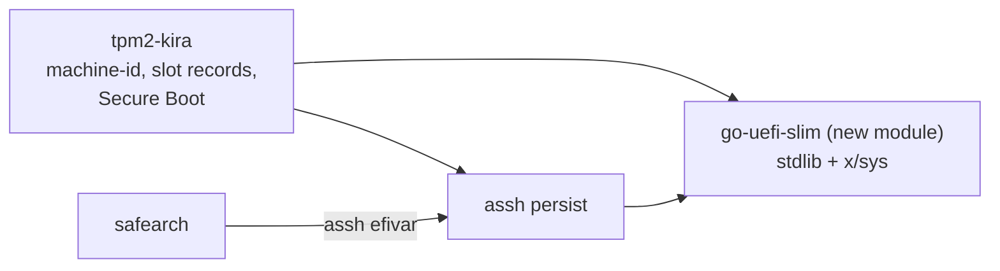

# PLAN: faster test runs

Status: **done (2026-11-02), I1-I6.** Confirmed by the owner. The owner: implement all. Where the time goes, from the last run: a boot is about 43 s on Arch, of it Argon2id 11 s (Debian's run: 30 s); hibernate steps 90-210 s; the hibernate test repeats the VM test's setup; fixed sleeps.

- [x] I1. A time for every step in `tools/vmtest.py` and `tools/hibernatetest.py` (the report and the output), a summary of the slowest at the end. First, so the rest is measured: the run before and after each step below. **Done: cf28310.** Baseline (from fresh, measured): VM test 957/1048 s Arch/Debian, hibernate 1240/1171 s; `.local/runs/i/baseline`.
- [x] I2. The hibernate test starts from a setup already made (a snapshot of its own tag, shared with the VM test where the state is the same, `--save-setup`), never `fresh` or `export` overwritten; a run from `fresh` remains what a final proof is. **Done: a224e6d.** `--save-setup`, `--from-setup`, `--drop-setup`, snapshots `setup` and `hib-setup`; localvm refuses to replace or remove fresh and export; shown by `.local/runs/i/t2`, `t3`.
- [x] I3. Fixed sleeps go: `hibernatetest.py:552` (15 s), `vmtest.py`'s 5 s after a boot, and the others: wait for the state (AGENTS: "they wait for a state, never for a time"). **Done: 33be9f5.** V5 23 -> 3.5 s; the 5 s after a boot wait for a login; a failed port look 5 -> 2 s; a typed boot on Arch 68 -> 48 s. `localvm.send`'s 0.2 s is pacing, kept. `.local/runs/i/t3`.
- [x] I4. Guest memory below 4 GB, as low as is measured to hold: Argon2id's 1 GiB must never reach swap, and the hibernate image must still fit. Both machines; PCRs unchanged (`fresh`'s, as `noreboot`'s check did). **Done, not lowered: 3185e21.** 4096 stays. 3072 keeps the PCRs (down to 2816) and the boot after a wrong pepper is killed for memory on both machines; below 2816 PCR 0 and 1 move; 2048 kills a plain typed boot on Arch; 1536 kills tpm2-kira-boot. No time gained (hibernate 754/868 s against 752/902 s). No swap touched, nothing killed at 4096 (new checks). `.local/runs/i/mem`, `tools/LOCALVM.md`.
- [x] I5. Argon2id cheaper in test boots only. The cost stays a constant of the code; only a Go build tag (not a flag, an environment variable, a config or the LUKS token: anything at run time would be a downgrade an attacker could reach) gives a test build a lower one, and `tools/vmtest.py --fast-kdf` builds that. A test shows a release build (no tag) has the real cost and that the real packages carry no trace of the tag. **A final proof runs without it**, and a report says which it was. Disks enrolled with one cost don't open with the other. **Done: ec9a5fd.** Tag `kira_test_fast_kdf`; the recipes never name it and run `packaging/release-binary-check.sh`; `internal/diskkey/release_test.go`; every run checks its package. Vault, phone, aSSH and safearch derive nothing with the cost. `--fast-kdf` run, all pass: VM test 686/696 s, hibernate 1002/919 s; `.local/runs/i/fast`.
- [x] I6. The numbers before and after, in `docs/TESTING.md`. **Done: 7874bdd.** Final proof at ec9a5fd without `--fast-kdf`, from fresh: VM test 168 and 159 checks, 833/922 s (`.local/runs/i/final/vmtest`); hibernate 146 and 135, 1064/1074 s (`.local/runs/i/final/hib`); `make test-all` pass (`.local/runs/i/test-all-pre.log`). No check removed; the hibernate reports' V2/V4 names carry a boot_id. Not shown, as before: Arch V3, Debian V2 and V4-reverted (the kernel refused the image, the memory map differs), Debian V4 step 5's resume.

---

# PLAN: PCR 7 in the channel secrets' policy; the go-tpm session leak

Status: **confirmed (2026-11-02), done (2026-11-02).**

- [x] H1. go-tpm (`go-tpm/`, a new branch `fix/policy-init-leak` from `main`, not on `feat/hierarchy`): a session whose `Init` fails after `StartAuthSession` (a failing `tpm2.Policy` callback) is flushed; today `execute()` returns without `CleanupFailure` and three failures end in `TPM_RC_SESSION_MEMORY`. A test that fails without the fix; the PR text in `.local/`; no PR opened.
  - Done: `go-tpm` `fix/policy-init-leak` `c15c3d9`, from the fork's `main` = upstream `c395998`. On `golang:1.24`: 611 passed, 0 failed (`.local/runs/h1/fixed-all.log`); without the fix 4 of the 5 new tests fail (`.local/runs/h1/without-fix.log`; the fifth guards the retry). PR text: `.local/go-tpm-PR-policy-init-leak.md`. No PR opened; nothing in the workspace uses the branch.
- [x] H2. tpm2-kira: the three callback sessions (`nvslot/policy.go`, `nvslot/nvram.go`, `phonegate/tpm.go`) use explicit sessions that are flushed, as `channel.go` does, until the fix is upstream. A test: repeated failures on one connection never end in `TPM_RC_SESSION_MEMORY`.
  - Done: tpm2-kira `10b54a9`; `TestFailuresLeaveNoSession`, which fails with the flushes taken out (`.local/runs/h2/mutation.log`). Probe of the unfixed go-tpm on the Arch VM: the 4th failure on one file is `TPM_RC_SESSION_MEMORY` on `/dev/tpmrm0` and `/dev/tpm0`; closing clears `tpmrm0`, not `tpm0` (`.local/runs/h2/probe.log`). A real boot reaches it on `/dev/tpmrm0` only in a boot nobody approved, with no change of verdict, except a slot that would open after three refused ones on one connection.
- [x] H3. The channel secrets' first branch becomes `PolicyPCR(7 as sealed, 15 == 0)`, in one constant: a Microsoft-signed live USB and Secure Boot off no longer open them. The signed branch stays. A moved PCR 7 (db or dbx update) means sealing them again with the signing key: `status` and `control` say so, and `slot approve` does it. Debian's edited GRUB entry still opens them (PCR 7 unchanged): stays in the accepted risks. A changed PCR 7 means no gate: the phone finds no machine. safearch has no channel secrets; its seals already read 7 and 15.
  - Done: tpm2-kira `d62a72d` (blob 20), docs in the commit after it; `TestChannelFollowsPCR7`, `TestChannelSealedForTheNextBoot`, `TestChannelSecretsSealed`. `make test-all` 944 passed, 8 skipped, 0 failed (`.local/runs/h3/test-all.log`); VM test Arch 157, Debian 148, 0 failed (`.local/runs/h3/vmtest`); hibernate test Arch 137, Debian 126, 0 failed, the same "not tested" items as before (`.local/runs/hibernatetest-20261102-015120`). `core` did not change: no `./pin tpm2-kira`, the vault and Marify not run. Not shown: a gate opening the object in a VM's initrd, a real db or dbx update.
- H4. Decided (2026-11-02): tpm2-kira's channel secrets stay at PCR 7 and 15 for now. More PCRs would silence the phone in the cases it exists to report; on GRUB, 8 and 9 would close the `break=` route, at a reseal per rebuild. The list is in one place, if that changes.

---

# PLAN: the slot's channel secrets sealed; shared code where it belongs

Status: **confirmed (2026-11-01), done (2026-11-02).** Order below is the owner's: the highest priority first, then the helpers the libraries already have.

## Goal

- `NoisePrivate` and `AdvKey` leave the world-readable EFI variable `KIRAslotN` and are sealed in the TPM.
- Docs and comments the reworked `docs/SECURITY-BACKGROUND.md` found stale are corrected.
- Duplicated UEFI/UKI code goes into `go-uefi-slim`; hand-written policy digests use go-tpm's `PolicyCalculator`.

## Steps

- [x] G1. Stale text: `docs/BOOT-INTEGRATION.md` and `docs/SSH.md` (`close --resume`; `ssh-child`'s uid; "Not run on a VM yet: ... the SSH CA"), `SECURITY.md:90,143` (who can read a slot record), `internal/nvslot/blob.go`, `internal/admin/slot_remove.go` (the recovery stash), `tpm2-kira/AGENTS.md` (Secure Boot: what this branch does: it reads and judges; key creation, enrolment and db signing are only on `exp/debian-uki`).
  - Done: tpm2-kira `da71964` (docs), `9af084b` (the two comments).
- [x] G2. **Decided 2026-11-01, option A (replaces the design in this step): the object's policy is `PolicyOR(PolicyPCR(15 == 0), PolicySigned(signing key, nonce))`, each branch with `PolicyCommandCode(Unseal)`. Not under the slot's policy: an unapproved boot must still start the gate, so the phone shows "changed"; further-phone and salt enrolment on the running system use the signing key. Before the close, anything booted on the machine can read them (`SECURITY.md` accepts that); the wire does not change. Phones enrolled again (blob 19).** **Security: the channel secrets sealed in the TPM** (a local user reads `KIRAslotN`, mode 0644, efivarfs; a user can imitate the Bluetooth endpoint). `NoisePrivate` and `AdvKey` are sealed under the slot's policy (PCR 15 included), so they open at the gate and close with everything else; the blob carries only the sealed form. To establish before coding, and to report if it does not fit: what needs them after the close (enrolling a second phone on the running system, `control`, status): a key made at enrolment and only sealed needs no unseal; anything that must read it there needs a design decision by the owner. Whether the channel's static key should instead be a TPM key doing the agreement itself (the boot key already can) is worth weighing, against the phone's protocol staying unchanged. Blob version raised. Tests: the record holds no clear secret (a test over the bytes); after the close the secrets refuse; the phone flow (`core`'s tests, the emulator). Then the same check over every other field of the blob: nothing else secret in clear. Breaks: phones enrolled again.
  - **Study (2026-11-01), the design as written does not fit:** (1) on the running system, after the close, `phone enrol` for a further phone (`attest.go:418,507`: XX with the same static key, the same AdvKey given out) and `phone salt enrol` / `luks enrol` (`factor_enrol.go:171`: a whole gate, IK) both need the clear secrets. (2) Under the slot's policy the gate cannot start in a boot nobody approved: the phone never sees its "changed" diff (§13.4), which SECURITY.md gives as the reason sealing to the PCRs was rejected. Recommended: `PolicyOR(PolicyPCR(15 == 0), PolicySigned(signing key))`, `PolicyCommandCode(Unseal)` in each branch; the wire is unchanged. Owner's decision.
  - The other fields: nothing else secret in clear.
  - Done: tpm2-kira `3c89bb7`; `TestChannelSecretsSealed`, `make test-all` 937 passed, 0 failed. A third use on the running system came up: `phone gate` opens them with the signing key after the close.
- [x] G3. `go-uefi-slim`: a new generic `uki` package: PE sections, `.pcrsig` and systemd's PCR signature JSON (`ParsePCRSignatures`, today twice: `assh/hostkey/signed.go`, `tpm2-kira/internal/measure/pcrsig.go`; compare the two first, and report any difference: it may be a bug in one), PCR 11's section measurements (`ukipredict.go`), PCR 4's Authenticode input where generic. aSSH and tpm2-kira use it; their copies go. The module stays standard library and x/sys: what needs go-tpm stays with its user. Its tests, fuzz of the parsers; `./pin go-uefi-slim`.
  - Done: `go-uefi-slim` `8f7d9c7` (`uki`: tests, 3 fuzz targets 40 s each, PCR 11 equal to `systemd-measure calculate`), aSSH `a4c80a1`, `78b1fac`, tpm2-kira `09b563c`, `f71b99e`. The two `ParsePCRSignatures`: same behaviour; tpm2-kira's struct had an unread `Pkfp`.
- [x] G4. Policy digests with go-tpm's `PolicyCalculator`, replacing the hand-written hashes in `core/attest` (`slotpolicy.go`, `releasekey.go`, `bootkey.go`), `core/vaultproto`, `assh/hostkey/policy.go`, `signed.go`. Byte-identical digests, shown by tests with fixed expected values taken **before** the change, and against a real TPM session. Where the calculator cannot express something, the hand-written line stays, with why.
  - Done: tpm2-kira `2be69df`; the fixed values were taken before the change (`.local/runs/g4/golden.txt`), `TestPolicyDigestsFixed`, `TestSignedPolicyFixed`, `TestSlotPolicyDigestIsTheTPMs`. aSSH already used the calculator: nothing to replace. `ApprovedPolicy` stays by hand: it goes on from a digest. `ApprovalDigest` and the PCR composite are no session's digest.
- [x] G5. Tests: each suite; because `core` changes: `./pin tpm2-kira`, the vault's tests, Marify's emulator test; the VM test and the hibernate test on both machines, in parallel; safearch `tests/run.sh` after `./pin assh`. Then `docs/SECURITY-BACKGROUND.md` follows (the finding moves out of §18, the format section, §17's results).
  - Done (`.local/runs/g5/`, tpm2-kira `75121e2`): VM test Arch 157, Debian 148; hibernate test Arch 137, Debian 126, 0 failed, the "not tested" items of §18; `make test-all` 937; aSSH 81; go-uefi-slim 46; vault 26; safearch 335, 1 skipped; Marify ALL PASS. `tests/vm.sh` not run again: aSSH's behaviour did not change. `-global ICH9-LPC.noreboot=true` (tpm2-kira `73d53dc`) cures the resumed guest's reset (same boot_id 75 s after the first login); `fresh`'s PCRs 0-9, 11, 14, 15 do not move. A real radio on a VM: not shown.

Not now: the swtpm helper's 4 copies, the TPM open retry's 2 copies (medium and low priority in the review).

Follow-up: `uki.MeasuredSections` lacks `.dtbauto`, `.profile`, `.hwids` and `.efifw`, which systemd-measure 262 knows; a UKI with them is predicted wrong (the check against the event log should catch it at a seal, untested). Left as it is by the owner's decision.

---

# PLAN: the SSH CA closes by PCR 15 (V2), the TOTP close and GRUB's `break=`

Status: **confirmed (2026-11-01), in progress.**

## Goal

Take variant 2 of the closing experiment (branches `exp/close-pcr15`:
aSSH `ba68fab`, tpm2-kira `5318f7a`; VM test PASS on Arch and Debian from
`fresh`) into the projects:

- aSSH's CA has no window index any more: `PolicyAuthorize ;
  PolicyCommandCode(Sign) ; PolicyPCR(15 == open value)`. The TPM itself refuses
  a signature once PCR 15 is extended. No approval can leave PCR 15 out.
- The same close shuts tpm2-kira's TOTP codes and every other slot-bound
  secret (evaluation below).
- GRUB's `break=` hole is closed (evaluation below).
- The learnings of variants 1 and 3 are kept (HISTORY.md, docs).

## The three experiments, what each taught

| | V1: the window is slot 0's generation index | V2: PCR 15 in the CA's policy | V3: Debian on systemd-boot + UKI |
|---|---|---|---|
| VM test | Debian PASS; Arch: all functional checks pass, its new log check did not find `cap`'s line in the journal | PASS on both | Arch PASS; Debian FAIL (PCR 11 of slot 0, libtss2 dependencies) |
| Kept as | HISTORY.md (why not a counter window) and the three gaps it found | this plan | HISTORY.md / BOOT-INTEGRATION.md (why not yet), branch kept as reference |

**V1, why the CA's window is no counter (for HISTORY.md):**
- One index for two purposes ties the CA to TOTP slot 0: without slot 0, there is no CA, and deleting slot 0 stops it.
- The window stays open for the whole code screen, because slot 0's codes read the same index. It can't close when the host key is certified.
- Root holding the signing key can reopen the CA in the same boot: with an empty owner password, delete the read-locked index and define it again alike (same Name), then write it with the signing key. aSSH's own window can't be reopened that way.
- A fail-stop `cap` turns a persistent TPM fault into a reboot loop; Debian has no escape short of rescue media.
- Gaps it found in today's design, all three fixed by step B2 below:
  - a DA lockout makes `cap`'s read-lock fail silently;
  - a CA kept with SSH off is never closed on Debian;
  - the close before a resume doesn't lock the codes.

**V3, Debian on systemd-boot + UKI (for HISTORY.md and docs/BOOT-INTEGRATION.md):**
- Debian 13's systemd 257 has no `systemd-pcrosseparator`.
- Its dracut systemd initrd reports "No complete TPM2 support detected" and measures no `enter-initrd` into PCR 11 (even with libtss2 in the image), so slot 0's PCR 11 prediction fails.
- `grub-efi-amd64-signed` is `Protected: yes`.
- `kernel-install add-all` doesn't find Debian's kernels in `/boot`.
- Debian's `55-initrd.install` adds `/boot/initrd.img-*` as a second initrd.
- Removing `/etc/kernel/postinst.d/dracut` breaks dpkg.
- The package needs the libtss2 dependencies.
- Worth it once Debian ships a systemd whose initrd measures (≥ 258). The conversion script and the `secureboot` command are on `exp/debian-uki`.
- One bug found there holds on Arch today: `tpm2-kira.service` has `Sockets=` in `[Unit]`, where systemd ignores it. Fixed in step B5.

## Evaluation: the TOTP close

Today, codes, the sealed machine-id, the TPM salt and the phone's release key are
closed by `cap`: it read-locks each slot's generation index when the initrd is
left. Gaps (V1, warned): a DA lockout makes the read-lock fail while `cap` exits 0;
the close before a resume doesn't lock them; `cap` fails open.

| Option | How | + | − |
|---|---|---|---|
| a. V1's fix | generation indices noDA, `cap` fail-stop, the close before resume = `cap` | small | two closing mechanisms (PCR 15 for the CA, read-lock for slots); fail-stop `cap` can loop |
| **b. PCR 15 for everything (recommended)** | every slot object's policy gets `PolicyPCR(15 == 0)` after `PolicyAuthorize`, exactly as V2's CA: one place in code, `nvslot.ApprovedSessionThen`, which every user (codes, machine-id, phone gate, salt) goes through | one close for the CA and every secret; TPM-enforced; lockout irrelevant (PolicyPCR has no DA); the close before resume covers the codes; `cap`, `CapCodes`, READ_STCLEAR and the cap unit/script go | every slot sealed again; every unseal must happen before the close (a test proves it) |

With b, the generation index stays only for revocation (`PolicyNV(G == n)`, raised
by `slot approve`) and becomes noDA (aSSH's rule: only a PIN index counts), so a
lockout doesn't stop the codes at boot.

## Evaluation: GRUB's `break=`

**WARNING (current code vs. tpm2-kira/AGENTS.md):** AGENTS.md says Debian's CA
"trusts no PCR-7-only slot", but `sshCASlots` (`internal/admin/remote_hostkey.go`)
gives every machine CA slot 1 = {7}, and `slot add`'s fallback slot 1 is
`0e,7e` on GRUB too.

With GRUB, Secure Boot verifies GRUB and the kernel, not the command line or the
initrd. Someone at the console edits the entry (`break=`, `rdinit=/bin/sh`,
`init=`) and gets a shell before any close. PCR 0 and 7 are unchanged, so the
CA's slot 1 signs a key of theirs and the fallback slot computes valid codes.
PCR 8 (GRUB measures every command and the kernel command line) and 9 (the
initrd) do change.

| Option | Fixes it? | Cost |
|---|---|---|
| **1. On GRUB, no slot without PCR 8 and 9 (recommended)** | yes: an edited entry changes PCR 8 | no fallback code and no fallback CA slot on Debian. After an unapproved kernel change the boot shows no code and serves the temporary key; the passphrase still works. `slot approve` in the hooks covers normal updates. |
| 2. A GRUB password (superusers, entries `--unrestricted`) | partly: stops editing at the menu, not another shim-signed boot path or a stolen disk in another machine | control advises it (it never edits grub.cfg) |
| 3. Earlier close (init-top) | no: `break=top` and `rdinit=` come before any script | — |
| 4. UKI (V3) | yes: the command line is in the signed image | not yet on Debian 13 (above) |

Recommended: 1, with 2 as advice in control's step 1, and 4 later.
On Arch (UKI), slot {7} stays. Its known limit (any image signed with the same
db key) remains in SSH.md.

## Steps

### A. aSSH (`assh/`)
- [x] A1. Take V2's change (`ba68fab`) onto aSSH's branch and review it against the AGENTS rules:
  - the CA's policy ends in `PolicyPCR(15 == open value)`; the close is `PCR_Event(15, "assh-close")` in every bank;
  - `--open-events` / `ASSH_CA_OPEN_EVENTS` for once-approved CAs only;
  - W, `--window-handle`, `--window-open`, `ASSH_WINDOW_*` and `close --ca` go;
  - file format 5.
- [x] A2. The TPM open wait (asked for earlier): `openTPM` waits for `/dev/tpmrm0` and retries the open at least 3 times within a bounded time, like tpm2-kira's `tpmdev.Open`. A TPM that never answers is an error, never "no CA". Tests.
- [x] A3. Docs:
  - AGENTS.md: "The window is the CA's own policy" becomes "PCR 15 in the CA's own policy closes it", fail-stop;
  - README;
  - HISTORY.md: W → PCR 15, why PCR 15 was replaced by W in `93d79df` and why that no longer applies (PCR 15 is in the CA's policy, not in the approvals), and why not a counter window (V1).
- [x] A4. `go test -count=1 ./...` (swtpm): all packages pass. aSSH `d21cdb0`, `6fd55d5`, `6274115` (README examples).

### B. tpm2-kira (`tpm2-kira/`)
- [x] B1. Take V2's change (`5318f7a`, now `fbc65c1`), on top of A via `./pin assh` (`6b6e7cb`):
  - `tpm2-kira-close.service` (Arch, `initrd.target` requires it, fail-stop);
  - Debian's init-bottom close with `panic`;
  - the close in `run` after the certificate;
  - the close before resume.
- [x] B2. TOTP and the other slot secrets (option b):
  - `PolicyPCR(15 == 0)` after `PolicyAuthorize` in every slot object's policy (`nvslot`), blob version raised;
  - generation indices noDA, without READ_STCLEAR;
  - `cap` removed: `CapCodes`, `tpm2-kira-cap.service`, the init-bottom cap, the plan's references.
  - The close runs whenever the plan has the TPM part **or a CA exists** (the "CA kept, SSH off, no slot sealed" case).
  - Tests: after the close, every slot object (codes, machine-id, salt, phone release key) refuses; a lockout doesn't stop the codes before the close; every boot path (SSH, phone, vault, TPM salt) unseals before the close.
- [x] B3. GRUB (option 1):
  - on a GRUB boot, `sshCASlots` gives only slot 0 ({0,2,7,8,9}) and `slot add` makes no PCR-7-only fallback; the reason is said in control;
  - control's step 1 advises a GRUB password (judged in status: red "the GRUB entry can be edited at the console");
  - tests for both selections.
- [x] B4. Learnings:
  - HISTORY.md: V1 (above) and V3 (above);
  - docs/BOOT-INTEGRATION.md: "Debian with systemd-boot and a UKI: not yet, and why";
  - AGENTS.md: the close steps in "One boot on every distribution", the Debian/GRUB sentence made true.
- [x] B5. `Sockets=` moves from `[Unit]` to `[Service]` in `tpm2-kira.service` (V3's finding).
- [x] B6. Test tools:
  - hibernatetest's V4 rewritten for a fail-stop close;
  - vmtest checks: PCR 15 extended in the running system, the close unit ran, a slot object refuses after the boot, no PCR-7-only slot on Debian.
- [x] B7a. `make test-all`: 648 pass, 0 fail (tpm2-kira `acc5603` B2, `f55abb6`+`cd2e53a` B3, `2c38ddb` B4, `18f0cfa` B5, `eca2def` B6; log `.local/runs/b2-b6-test-all-final.log`).
- [x] B7b. The VM test `--target both`, sequentially, from `fresh`; then `hibernatetest.py` (its V4 is new: the resume's boot without the TPM; the serial regexes for Arch's emergency target and Debian's panic text are untested).

Noted from B2 (a trade-off, not a defect): the storage primary and the TOTP key are now noDA like the generation index, so that a DA lockout never stops the boot; tpm2-kira holds no PIN in the TPM, so nothing of its own loses protection - anything else sealed under that primary with a password would. GRUB's fallback is `7e,8e,9e` (the unified rule), `control` is red until GRUB has a superuser password.

### C. safearch (`safearch/`), after `./pin assh`
- [x] C1. Its slots drop PCR 15; `ASSH_CA_OPEN_EVENTS` names the events up to the agent; `ASSH_CA_WINDOW` and the window settings go (this resolves the known `tests/run.sh` failure).
- [x] C2. The agent unit: W's close steps go, and `ExecStopPost=assh close` stays as the close on every way out. `systemd-pcrmachine` stays ordered after the agent; it now closes the CA a second time.
- [x] C3a. `tests/run.sh`: 331 passed, 0 failed, 1 skipped (safearch `01f609a`).
- [ ] C3b. `tests/vm.sh`: acknowledged, not run: 14 GiB free in `mkosi.test/`, the script requires 16.

### D. Pins and cleanup
- [x] D1. `./pin assh`; commits in tpm2-kira and safearch. B2 changes `core/` (the boot and release keys' policy carries PCR 15): `./pin tpm2-kira`, the vault's tests and Marify's emulator test.
- [x] D2. The `exp-v1` and `exp-v2` worktrees and their branches go (their directories keep logs, runs and a vault copy, git-ignored). `exp-v3` per open question 4.

### E. PCR 15 hardening (review of 2026-11-01, all items confirmed)

- [x] E1. safearch `identity`: the `sealed` extend fails the boot. `close()` without
       `--graceful`'s silence: a failed extend with a TPM present ends the unit with an
       error (the boot stops in the emergency target), never "WARNING, continue": without
       it, any root process unseals the machine-id again in that boot (its seal is 7,15+11
       with 15 = the combination alone). Test in `tests/run.sh` (the mock extend fails).
- [x] E2. The failure ladder (the owner's decision, 2026-11-01; replaces a power-off, then
       a plain hard reboot). aSSH `hostkey.Close`, generic, typed result, `assh close` prints it:
       1. `PCR_Event(15)`, one retry, read back in every bank: not moved is a failure.
       2. The kill switch: `shEnable` by the owner's empty authorization (the platform's if that
          refuses), then `ehEnable`, `phEnable` last by the platform's; a platform refusal is
          said and harmless. Added on the way: the platform's authorization goes random before
          `phEnable`: on swtpm a resume from S3 sets `phEnable` again and the empty authorization
          set `shEnable` back.
       3. `PCR_Event(7)`, read back.
       tpm2-kira `internal/bootclose`, `tpm2-kira-boot close [--resume|--late]`:
       4. 2 or 3 held: the boot goes on, console and status/control red.
       5. No device after the wait and no firmware sign (TPM2/TCPA table, event log, the stub's
          variable): nothing to close, no error.
       6. A firmware sign and no answer: one hard reboot, counted in `KIRAcloseReboot`; then
          the passphrase and `tpm2-kira-late-close.service`. Best effort; residual risk in SSH.md.
       7. It answers and refuses all: hard reboot, not counted (Arch `FailureAction=reboot-force`,
          Debian `reboot -f`, SysRq `b`, the loop): the single exception to the passphrase by hand
          (tpm2-kira/AGENTS.md, SSH.md, with the way out).
       The pre-resume close: anything but PCR 15 itself (or step 5) is no resume.
       safearch `identity`: a failed `sealed` extend runs `assh close`; only if that fails, the reboot.
       `shEnable` across S3 (swtpm, `TestCloseAcrossSuspend`): stays clear; `phEnable` comes back.
- [x] E3. tpm2-kira: "PCR 15 is zero at the code screen" is checked, not assumed.
       `slot approve` and `control` read the firmware event log: any event in PCR 15
       before the code screen is red ("PCR 15 is measured by the firmware or the boot
       loader: nothing of tpm2-kira's opens on this machine") and the approval refuses.
       `measure` replays PCR 15 from the log for that check. Tests with a log holding a
       PCR 15 event.
- [x] E4. aSSH `hostkey.Close` writes the measurement record systemd-pcrextend writes:
       one JSON line per bank in `/run/log/systemd/tpm2-measure.log` (`pcr`, `digests`,
       `content_type: "systemd"`, `description: "assh-close"`), where that directory is
       there (not on a TPM simulator); the record is for whoever replays PCR 15 (status,
       pcrlock later), it changes nothing of the close. Test: the line's digests equal
       the extend's. No `.pcrlock` file (decided: not now).
- [x] E5. tpm2-kira SSH.md "Known limits": slot 1 and PCR 15 at zero in any db-signed
       boot that gives a shell before the close; what F (signed PCR 11) changes about it.
       Check and say whether systemd-boot's command-line editor is off with Secure Boot on
       (loader.conf `editor`), so that no such shell comes from an edited command line.
- [x] E6. safearch SECURITY.md: the CA is open from `sealed` (initrd) until the agent's
       close in the root; what runs in between (udev, tmpfiles, journald, usbguard: the
       signed image), and that this is accepted. The larger change - the host key certified
       in the initrd, handed over in /run - noted as an option, not done.

### F. One PCR rule for every use case

The rule: **every slot reads PCR 7 and the image; slot 0 adds the platform (0, 2, 4).**
PCR 4 is in by decision (2026-11-01): it goes again if it makes trouble in the real world
(a firmware that measures more into 4 than the loader and the image, an unpredictable
value) - then this table, `pcrtips`, the defaults and the docs lose it in one change.

| | the image | slot 0 (exact) | slot 1 (after a firmware or option-ROM change: purple) |
|---|---|---|---|
| UKI (Arch, safearch) | PCR 11, **signed** by the owner's PCR key for `enter-initrd` (the stub's `.pcrsig`) | 0, 2, 4, 7 + 11 signed | 7 + 11 signed |
| GRUB (Debian) | PCR 8 and 9, approved after every rebuild (GRUB signs nothing) | 0, 2, 4, 7, 8, 9 | 7, 8, 9 |
| PCR 15 | never in a slot: the close | | |

Why these and not others (goes into docs/SSH.md and `pcrtips`):
- 7: Secure Boot on, with exactly these keys, and the certificate that verified each
  binary. A different signer, Setup Mode, or Secure Boot off changes it.
- the image: a UKI in 11 (sections and the phase), which Secure Boot already verified;
  on GRUB 8 (every command, the kernel command line) and 9 (the files loaded), which
  Secure Boot does not verify - the reason no GRUB slot may lack them (`break=`).
- 0 and 2: the firmware's code and the option ROMs - the platform. A firmware or NIC
  change moves them: slot 1 is for that.
- 4: the boot loader's binary and the image the firmware loaded (EV_EFI_BOOT_SERVICES_APPLICATION:
  systemd-boot and the UKI; shim and GRUB), a rollback to an older loader. It moves at
  every loader and kernel update, so it must be **predicted for the next boot** (`4u`),
  never replayed from this boot's log alone: the log's application events replaced by the
  Authenticode digests of the files on the ESP as they will be booted (the loader, the
  newest UKI or kernel; go-uefi-slim's Authenticode), as 8 and 9 are predicted on GRUB.
  An `e` source for 4 would break slot 0 at every kernel update. safearch: 4 is the
  loader and the UKI the build made; its approvals are made in the initrd from the live
  values, so a build's update moves slot 0 to slot 1 (purple) until the identity is made
  again - said in SECURITY.md; if that is too much in practice, 4 goes there first.
- left out, and why: 1 (firmware settings and boot order: changes with a setting, says
  little); 3, 5, 6 (option-ROM settings, the partition table, resume events: noise);
  12, 13 (the stub's command line, credentials, extensions: inside a
  UKI they are in 11; with addons an owner adds 12 by hand); 14 (shim's MOK list: a
  MOK that verifies a kernel is recorded in 7 as well).
- signed PCR 11 for `enter-initrd` alone (safearch's rule, now tpm2-kira's): the slots
  are used in the initrd and closed before `leave-initrd`; a root cannot replay a phase
  that was never signed.

Steps:
- [x] F1. The selections, the same shape everywhere (after B3):
       - tpm2-kira UKI: slot 0 `0e,2e,4u,7e,11u`, slot 1 `7e,11u`; CA slots {0,2,4,7,11}, {7,11}.
         `4u`: a new source in `measure` (the prediction above); `slot approve` and the
         hooks approve it after every rebuild and after `bootctl update`.
         Until F2, 11 is predicted and approved by the hooks: slot 1 then survives a
         firmware change, not an unapproved kernel - said in control.
       - tpm2-kira GRUB: slot 0 `0e,2e,4u,7e,8e,9e`, slot 1 `7e,8e,9e`; CA slots the same
         (B3 as changed). `4u` on GRUB: shim and GRUB from the ESP (what the log's
         application events name).
       - `pcrtips`: the table above (4 predicted, `4u`).
       - aSSH README examples: `0,2,4,7+11` / `7+11` (signed) and the GRUB pair.
       - safearch: `IDENTITY_SLOTS="0,2,4,7+11 7+11"` (the build's key signs every
         phase; the identity key `enter-initrd` alone - unchanged); `settings_pcrs`,
         tests, SECURITY.md (the PCR 4 note above).
- [x] F2 (VM test and hibernatetest PASS at tpm2-kira a101fbf: `.local/runs/vmtest-final-a101fbf`, `.local/runs/hibernatetest-20261101-220503`). Signed PCR 11 on Arch, tpm2-kira's own PCR key:
       - `setup` makes an RSA-2048 PCR key (aSSH's `Signed` takes that, every TPM
         verifies it), `/etc/tpm2-kira/pcr.key` (root's alone) and `pcr.pem`; `control`
         asks before it writes `PCRPrivateKey=`, `PCRPublicKey=`, `Phases=enter-initrd`
         into `/etc/kernel/uki.conf` (an exception like HOOKS: asked every time), which
         mkinitcpio 42's ukify build reads; `measure` checks the built UKI's `.pcrsig`
         holds exactly one signature per bank for `enter-initrd` by that key (as
         safearch's `compose_check`).
       - The CA's slots take 11 as `Slot.Signed` (`ASSH_CA_SLOT_N_SIGNED=11`,
         `ASSH_PCR_KEY`, `ASSH_PCR_SIGNATURE=/run/systemd/tpm2-pcr-signature.json`):
         a kernel update needs no approval of the CA; slot approve approves 0, 2, 7.
       - The TOTP slots: `nvslot`'s approved policy gains the nested
         `PolicyAuthorize(PCR key)` for 11 as aSSH's does (`PolicyPCR(11) ;
         PolicyAuthorize(key) ; PolicyPCR(rest) ; PolicyNV(G)`); the vault computes the
         same (`core/vaultproto.ApprovedPolicy`): a core change, the vault's tests and
         Marify's emulator test follow (`./pin tpm2-kira`). The phone's check of the
         boot key's policy is unchanged (PolicyAuthorize by the signing key).
       - Rollback stays: any UKI ever signed with the PCR key keeps 11 valid, like the db
         key; revocation is a new PCR key and the slots approved again - SSH.md.
       - Tests (swtpm, with a UKI's `.pcrsig` made by `systemd-measure sign`), the VM test.
- [ ] F3. Debian: unchanged GRUB rule (8, 9 approved per rebuild); the UKI path when
       Debian ships systemd >= 258 (HISTORY.md, exp/debian-uki).

- [ ] F4, not scheduled (withdrawn from this job 2026-11-01; the file `pcr.key` stays). The PCR key is held in the TPM (decided 2026-11-01, replaces the file `pcr.key`):
       an RSA-2048 key made inside the TPM by `setup`, not exportable, noDA, usable with no
       authorization and no PCR 15 in its policy (the UKI is built on the running system,
       after the close); `pcr.pem` stays as the public part. Root can still sign with it on
       this machine; a stolen disk or backup cannot carry it away (the signing key stays the
       only key that approves). ukify signs through an OpenSSL provider
       (`--signing-provider`, `PCRPrivateKey=` naming the key; `control` writes it into
       `uki.conf` as before). To establish first: does ukify's PCR signing take a provider
       key, and which package does that need on Arch (a new dependency: say so). A cleared
       TPM loses the key: a new one and the slots approved again. No file-key fallback.
       Tests with swtpm and the provider; the VM test on Arch. If ukify cannot do it, stop
       and report: the owner decides.
       Established before it was withdrawn; nothing of it is in the projects, a working
       patch is `.local/runs/F4-withdrawn-e7529e7.patch` (systemd 262, tpm2-openssl 1.3.0 from Arch's extra, swtpm): ukify signs
       with `--signing-provider=tpm2` and `PCRPrivateKey=handle:0x81008011`. It demands
       `SecureBootSigningTool=systemd-sbsign` beside a provider, and takes the public part as
       an X.509 certificate: `PCRCertificate=/etc/tpm2-kira/pcr.crt`, self-signed by the key.
       New dependency on Arch: `tpm2-openssl` (pulls `tpm2-tss`). Key at `0x81008011`.

Order: B (running) -> E -> F1 -> VM tests -> F2 -> VM tests, the vault, Marify -> D.

## What breaks (announced)

- F2: every TOTP slot and the CA are approved again for the new policy shape; a machine without `/etc/kernel/uki.conf` from control gets no signed 11 and its slot 1 fails at every unapproved kernel update.
- F2: blob version 18: every slot is sealed again, every authenticator, phone, vault enrolment and TPM salt made again. A slot's PCR 11 goes signed at its next approval once the image carries the signature; a vault enrolled before that is enrolled again (the pinned selection changes). A CA made before `uki.conf` keeps 11 approved until it is made again. The vault's state gains `pcr_key`.
- Every SSH CA is made again; clients get the new `@cert-authority` line.
- Every slot is sealed again (new policy, noDA generation index). Phones keep their enrolment if the release key's slot is only resealed; to be checked in B2, and said if not.
- Volumes bound to PCR 15 (`--tpm2-pcrs=15`) are enrolled again, since PCR 15 now changes after the code screen on Debian too.
- Debian/GRUB: no fallback code and no fallback CA slot. After an unapproved change, the boot shows no code and serves the temporary key; the passphrase still works.
- `ASSH_WINDOW_*`, `--window-*` and `close --ca` are gone: assh.conf files with them are refused.
- An old W index stays at `0x01802915`: `slot delete` / `assh ca remove --force` no longer know it.
- A failed close: on every machine with the TPM part or a CA, a TPM that answers and refuses everything reboots the machine again and again until the owner takes the way out (docs/SSH.md, "The close: what it can come to"): the emergency shell and panic of before are gone. A TPM the firmware has and that does not answer costs one reboot, then a passphrase-only boot, red in control.
- A degraded close leaves the TPM's owner hierarchy off, or PCR 7 moved, until the next boot: nothing of tpm2-kira's or aSSH's under the owner works in that boot; what else the owner keeps under that hierarchy on the machine stops as well.
- `tpm2-kira-boot close` before a resume is now `close --resume` in the Arch drop-in and Debian's local-top: the image is rebuilt.
- A new unit on the host: `tpm2-kira-late-close.service` in `sysinit.target.wants`; a new EFI variable `KIRAcloseReboot` while a reboot is counted.
- safearch: a failed `safespace-identity:sealed` extend with a TPM present goes down aSSH's ladder; only when all of it fails the machine reboots. A boot after the ladder has no identity until the next boot.
- A machine whose firmware or loader measures into PCR 15: `slot add`, `slot approve` and the CA's approvals refuse.
- F1: every slot's and CA's selection changes (slot 0 adds PCR 4, slot 1 is 7 + the image): slots are sealed again, the CA is made again, `4e` is refused. On a UKI without the PCR key's signature slot 1 no longer outlasts a kernel not approved.
- F1 safearch: a build's update moves slot 0 to slot 1 (purple) until `safespace identity clear` makes the identity again; `IDENTITY_SLOTS` changed: the identity is made again.
- safearch: the image is rebuilt and its CA made again.

## Decisions (2026-11-01)

1. Branch `feat/close-pcr15` in aSSH, tpm2-kira and safearch.
2. `cap` is removed: PCR 15 closes everything.
3. GRUB: no PCR-7-only slot; every slot on a GRUB boot includes the PCRs Secure Boot does not cover there (8 and 9).
4. `exp/debian-uki` stays as a local reference branch.
5. systemd-pcrlock: not now.

---

# PLAN: go-tpm upstream everywhere (the fork goes)

Status: **done (2026-10-31)**: steps 1-7; the VM test of tpm2-kira 7f182b5 passes on both machines.

## Goal

google/go-tpm took `NVChangeAuth` (#452, `c395998`, 2026-10-30). Every Go module
requires that commit, aSSH's `replace` to the fork goes, and with it the
exception that `tpmadmin` builds against other code than the rest. The fork's
commit `f241ee1` has the same tree as upstream `c395998`: nothing changes for
`tpmadmin`; the others gain #447-#452 (DA lockout reset and parameters, union
selector fix, NVChangeAuth).

## Steps

- [x] 1. aSSH (`4a8b77e`): `github.com/google/go-tpm v0.9.9-0.20261030171821-c395998989d7`,
       the `replace` removed; AGENTS.md ("hostkey builds with go-tpm as
       released": no fork any more). Tests (swtpm, tpmadmin's PIN change).
- [x] 2. tpm2-verifier (`cd31a77`): the same version; tests; `./pin tpm2-verifier`.
- [x] 3. tpm2-kira and its core (`7f182b5`; `make test-all` passes): the same version, the new aSSH and verifier
       pins; `make test-all`; the VM test.
- [x] 4. The vault (`751a5dc`, on `feat/root-ca`; unit and integration tests pass): the same version, `./pin tpm2-kira`; its tests.
- [x] 5. Marify (`613c488`; emulator test ALL PASS: 57 unit, 41 instrumented, 7 swtpm): `./pin tpm2-kira` (core.properties); the emulator test.
- [x] 6. Workspace: AGENTS.md (the `go-tpm/` row, the diagram, the go-tpm row
       of the pins), `pin` (no "assh's replace" line).
- [x] 7. The `go-tpm/` checkout leaves the workspace (it stays published).

## Open questions

1. ~~Step 7: remove the `go-tpm/` checkout?~~ Decided: yes (removed; every
   commit of it was on the fork's remote).
2. ~~The vault on `feat/root-ca` or a branch of its own?~~ Decided: on
   `feat/root-ca`.

# PLAN: a UEFI package of our own (replaces the go-uefi fork)

Status: **phases 1 and 2 built (2026-10-30)**: `go-uefi-slim/` (local commits, not published), used by
aSSH (`feat/uefi`) and tpm2-kira (`feat/uefi`); tpm2-kira's VM test passes on both machines
(fe8ae22, 129 checks each). Decisions: BSD
3-Clause; x/sys; built now and used in the projects; go-uefi fork branches stay. Renamed
`go-uefi-slim` (2026-10-31); `sigdb` takes every signature type of the specification.

## Goal

sbctl's upstream does not take the fork's efivarfs changes, so the fork stays a fork. A
package of our own replaces it:
- small, with the Go standard library alone (`golang.org/x/sys` at most, which aSSH and
  tpm2-kira already require);
- shared by aSSH and tpm2-kira, owned by neither (workspace AGENTS.md: "one shared EFI
  variable package that neither project owns");
- compatible with what sbctl writes and reads (Secure Boot layout, signature lists,
  signed variables), so sbctl can still take over a machine.

Measured cost of go-uefi in aSSH (2026-10-30), which this avoids:
- +422 KB binary;
- three new modules (go-uefi, afero, `pkg/errors`), plus `x/text`;
- a fork every consumer has to replace.

## What the standard library already has

- `debug/pe`: sections, the data directories, for Authenticode's hash.
- `encoding/asn1`, `crypto/x509`, `crypto`: PKCS#7 SignedData built by hand (no library),
  certificates, any `crypto.Signer` (a key file, the YubiKey through tpm2-kira's
  `internal/piv`).
- `encoding/binary`, `unicode/utf16`: variable and signature list layouts, names.
- `syscall` (`SYS_IOCTL`, `FS_IOC_GETFLAGS/SETFLAGS`) or `x/sys/unix`: the immutable bit.

## Steps

### Phase 1: EFI variables (for aSSH's `persist` and tpm2-kira; replaces the fork now)

- [x] 1. Repository `github.com/tpm2-trust/go-uefi-slim` (named 2026-10-31; first `uefi`), in the workspace
       as `go-uefi-slim/`. `go.work use`, a row in AGENTS.md's tables, `./pin status`.
- [x] 2. Package `efivar`:
       - `GUID` (parse, format, the mixed-endian binary form);
       - `Attributes`;
       - `Store{Dir}` (default `/sys/firmware/efi/efivars`) with:
         - `Read(name, guid) (Attributes, []byte, error)`;
         - `Write(name, guid, attrs, data)`: one write, truncate, append only with
           `APPEND_WRITE`;
         - `Remove(name, guid)`: a missing variable is `os.ErrNotExist`;
         - `List(guid)`.
       - Name check as `persist` does today.
       - The immutable bit: a check never creates; a write or removal lifts it and puts
         it back, also after a failure; only on the OS file system.
- [x] 3. Tests:
       - a temp directory: replace, a shorter rewrite, remove, a missing one, other
         attributes;
       - the immutable test skipped without `CAP_LINUX_IMMUTABLE`;
       - fuzzing the parsers;
       - on both VMs as root against efivarfs (as done for the fork).
- [x] 4. aSSH:
       - `persist` on `efivar` (same API);
       - the uncommitted go-uefi rework undone (go.mod, go.sum, `persist/efivar.go`; the
         README, TODO-SEC and HISTORY texts rewritten);
       - aSSH's tests;
       - tpm2-kira's `make test-all` against it.
- [x] 5. Workspace:
       - `go.work`: `./go-uefi-slim` instead of `./go-uefi`;
       - `pin`: the go-uefi check goes, the new module is shown like a pin.

### Phase 2: Secure Boot (for tpm2-kira's plan; built when that plan starts)

- [x] 6. `sigdb`: EFI_SIGNATURE_LIST / EFI_SIGNATURE_DATA, parse and build:
       - X.509 and SHA-256 entries;
       - the well-known GUIDs (global, image security database, Microsoft's owner);
       - the state: SecureBoot, SetupMode, PK, KEK, db, dbx, MokListRT.
- [x] 7. `authvar`: EFI_VARIABLE_AUTHENTICATION_2:
       - a timestamp plus PKCS#7 SignedData over name, GUID, attributes, timestamp and
         data;
       - signed by a `crypto.Signer`;
       - written through `efivar`.
- [x] 8. `authenticode`:
       - the PE image hash (`debug/pe`; checksum and certificate table left out);
       - SpcIndirectDataContent in SignedData, appended as WIN_CERTIFICATE;
       - the PE checksum updated;
       - verify against a certificate.
- [x] 9. Tests:
       - vectors from sbsigntools (`sbverify` in a container) and from sbctl (files it
         signed, enrolment files it exported);
       - fuzzing PE and signature lists;
       - the VM enrolment in Setup Mode (tpm2-kira's step 10).

## Results (2026-10-30)

- **Unit tests and fuzzing** for every package.
- **Reference tools** (Debian trixie):
  - `sbverify` accepts an image signed here;
  - an image `sbsign` signed verifies here;
  - a signature list is byte-identical to `cert-to-efi-sig-list`'s;
  - an update from `sign-efi-sig-list` verifies here.
- **Microsoft's certificates:** downloaded from Microsoft, identical to sbctl's, pinned.
- **Firmware** (OVMF with Secure Boot, `go-uefi-slim/internal/vmcheck`):
  - **Arch:** keys created as sbctl lays them out, its systemd-boot and UKI signed here.
    - It boots with Secure Boot on.
    - `sbctl status` and `sbctl verify` read the result as sbctl's own.
    - A UKI changed by one byte is refused ("Access denied").
  - **Debian:** boots through shim with Microsoft's certificates as enrolled here.
    - Side finding: Debian's kernel locks down under Secure Boot, which disables
      hibernation.
- **Projects:**
  - aSSH's suite passes;
  - tpm2-kira's `make test-all` passes; its VM test (`fe8ae22`) passes on Arch and Debian, 129
    checks each: slot records, the sealed machine-id and the SSH CA's variable on efivarfs;
  - safearch's `tests/run.sh`: 329 passed, 1 failed - `ASSH_CA_WINDOW`, the pending safearch
    upgrade (TODO-ASSH.md), not this.

## Open

- Publishing `github.com/tpm2-trust/go-uefi-slim` (the submodules' URL); until then builds work
  from the local checkouts only.
- safearch: its pin of aSSH and the nested-submodule check in `lib/assh.sh` are uncommitted;
  the safearch upgrade (TODO-ASSH.md) is not started.

# PLAN: the workspace's structure, as it grows

## Goal

The projects depend on each other more with every feature (aSSH under
tpm2-kira and safearch, tpm2-kira's core under the vault and Marify, three
go-tpm versions). Make every dependency explicit, pinned and cheap to
follow, and remove the duplicates, before more is built on top.

## Findings

1. **tpm2-kira's shared core is not a module of its own.** `attest/`,
   `transport/`, `vaultproto/` and `mobile/` depend on go-tpm and
   x/crypto alone, but the vault and Marify take them through the whole
   `github.com/mrwiora/tpm2-kira` module: its go.mod requires aSSH
   (replaced by a submodule), huh, go-attestation. Marify's core build has
   to edit that go.mod (drop aSSH) to build at all; the vault's module
   graph carries tpm2-kira's TUI libraries.
2. **The vault is not pinned.** `replace ../tpm2-kira` builds whatever the
   checkout is; every other consumer builds a pinned commit for a release.
3. **Two curated EK root stores.** tpm2-kira's `attest/ekroots/` (embedded
   into the phone app, Intel PTT) and tpm2-verifier's `vendors/` (a signed
   directory next to the binary, Intel) each pin vendor roots, with their
   own verification code.
4. **Three go-tpm versions.** tpm2-kira: upstream `36f2059` (the HMAC
   fix); aSSH: the same, plus a `replace` to the fork for `tpmadmin`;
   tpm2-verifier: v0.9.8.
5. **`pin` knows its pins by code.** Each new dependency means editing the
   script.
6. **`mkinitcpio-systemd-extras/` is used by nothing here** (tpm2-kira's
   own SSH server replaced its hooks).
7. **Nothing is pushed, and the workspace repository has no remote.** The
   submodules point at commits only these checkouts have.

## Steps (proposed - nothing is done before confirmation)

- [x] 1. **The shared core as a module of its own** (decided: inside tpm2-kira), in tpm2-kira's
      repository: `core/` with its own go.mod
      (`github.com/mrwiora/tpm2-kira/core`), holding `attest/`,
      `transport/`, `vaultproto/`, `mobile/`. tpm2-kira requires it
      (`replace ./core`), `go.work` uses it; the vault and Marify require
      the core alone. Marify's build-core drops its go.mod edit. The
      module boundary keeps the core free of tpm2-kira's `internal/` and
      of aSSH (it cannot import what its go.mod does not require).
      Done: tpm2-kira 86340f0, the vault 6c8c112, Marify 95ea722, the
      workspace e9d75fd; tpm2-kira's and the core's suites pass, the vault's
      too; Marify's Android run against it - see below.
- [x] 2. **The vault pins the core**: as aSSH is pinned - a git submodule
      `tpm2-kira/` in the vault, its go.mod replacing the core with
      `./tpm2-kira/core`, moved by `./pin tpm2-kira` (with Marify's pin);
      `go.work` gives the checkout for development. (A pseudo-version
      would have Go fetch tpm2-kira from its remote, and nothing is pushed:
      open question 5.)
      Done: the vault 215d1b8, go.work replaces the core at
      v0.0.0 with the checkout; the vault's tests pass from the pin.
- [x] 3. **One EK root store and verifier**: tpm2-verifier's `verify`
      package and vendor data become what the phone core and tpm2-kira
      check EK chains with; the phone app keeps embedding the data at build
      time (nothing added at runtime). Decided: tpm2-verifier is the EK
      root store - the vendor roots are curated there from now on - as a
      package every project uses (the phone core, tpm2-kira, the vault,
      tpm2-verifier's command), its data signed. A TPM of a vendor not in
      the store is not untrusted: the result says "vendor not known" - a
      risk to weigh, not a refusal - until its vendor is added.
      Design (to confirm):
      - **Where:** a package in tpm2-verifier, `ekroots`, that embeds its
        vendor directory (`go:embed`) with the `MANIFEST` and
        `MANIFEST.sig` it already has, and checks them at load against the
        signing key compiled in (`manifest`, SSH signature, namespace
        `tpm2-verifier-vendors`): a file that is not in the signed
        manifest, or differs, is never used.
      - **API:** `ekroots.Check(chain) Result` - `Verified` (vendor and
        chain), `VendorUnknown` (no root of that vendor: information, a
        risk, the boot is not refused for it), `Failed` (a known vendor's
        chain that does not verify: refused). The same result in the
        phone, tpm2-kira's `phone ekcert`, the vault and tpm2-verifier's
        command.
      - **Users:** tpm2-kira's core (`attest/ekcert.go`, the phone through
        it) instead of `core/attest/ekroots/`, which goes; tpm2-verifier's
        command keeps reading a newer signed directory next to the binary,
        through the same package.
      - **Pinned like the others:** the core requires tpm2-verifier
        (open question 6).
      Done: tpm2-verifier 68fe206..804ab7e (`ekroots`, the data in
      `ekroots/vendors/`), tpm2-kira 69bcd7a, 31b83d0 (the core on
      `ekroots`, `ek_vendor_unknown`), the vault 3d0795c, Marify 3f7a63b
      (the bind screen), the workspace a935f5e. The signature: the
      mechanism checks `MANIFEST.sig` against `manifest/allowed_signers`,
      which names no key yet - open question 7.
- [x] 4. **One go-tpm**: tpm2-verifier on the same go-tpm as the others
      (`36f2059`), and `./pin status` warns when two projects' go-tpm differ.
      Done: tpm2-verifier 6537aad (its tests, swtpm included, pass),
      `pin status` compares the go-tpm of every Go module.
- [ ] 5. **`pin` reads its pins from a manifest** (`pins.conf`: consumer,
      kind - submodule, properties line, go.mod - target), so a new
      dependency is a line, not code; `pin status` lists them all.
- [x] 6. **mkinitcpio-systemd-extras out of the workspace**: it was a
      reference only; the checkout is gone (its repository stays published).
      hashpwd2 likewise: tpm2-kira's combiner test holds its known answer.
- [ ] 7. AGENTS.md (workspace and the projects') follow each step.

## Open questions

1. ~~Step 1: inside tpm2-kira or its own repository?~~ Decided: inside.
2. Step 3: tpm2-verifier is the EK root store (decided). Still open: its
   store is a signed directory read at runtime, and the phone must not take
   roots at runtime - so the phone core embeds tpm2-verifier's vendor data
   at build time (`go:embed` through a package of tpm2-verifier's), and
   tpm2-kira's `core/attest/ekroots/` goes. tpm2-verifier then becomes a
   dependency of the core (go-tpm and yaml): decided, acceptable.
3. ~~Step 4: go-tpm `36f2059` for tpm2-verifier too?~~ Decided: yes.
4. ~~Step 6: remove `mkinitcpio-systemd-extras/`?~~ Decided: removed.
6. Step 3: the core module would require tpm2-verifier. Today every pin
   between projects is a git submodule, because nothing is pushed; a
   submodule `tpm2-verifier/` inside `tpm2-kira/core/` works offline but
   makes Marify's core build fetch it too (the archive of a commit has no
   submodules). Pushing tpm2-verifier and tpm2-kira and pinning by Go
   pseudo-versions (`go.mod`, `go.sum`) is the plain Go way and needs no
   submodule anywhere - for the core, aSSH and the vault alike. Which?
7. Step 3 (unsigned is fine for now): `manifest/allowed_signers` names no
   key and `MANIFEST.sig` does not exist, so the EK root data is checked against its manifest's hashes,
   not yet a signature. Whose ed25519 key signs it (`ssh-keygen -Y sign -n
   tpm2-verifier-vendors`)? Once its public key is in `allowed_signers`,
   `ekroots` uses signed data alone.
5. ~~Step 7: which remotes?~~ Decided: every project in
   github.com/tpm2-trust, tpm2-kira and the go-tpm fork in mrwiora; the
   workspace is tpm2-trust/tpm2-trust. Pushing is the owner's.
